# Examples

These images are drawn entirely with constixel: bundled IBM Plex fonts, built-in palettes, drawing primitives, and procedural shader functions. Most examples use 8-bit buffers; the player, fractal, shader studies, and home energy monitor use 32-bit RGBA. The e-paper weather display uses a 1-bit buffer.

## Build and run

From the repository root:

```sh
cmake -S examples -B build/examples -DCMAKE_BUILD_TYPE=Release
cmake --build build/examples --parallel
```

Run an example in a sixel-capable terminal, or pass a filename to any gallery example to write a PNG:

```sh
./build/examples/example_industrial
./build/examples/example_industrial plant.png
./build/examples/example_watchui player.png
./build/examples/example_weather weather.png
```

Without a filename, the player and Mandelbrot examples write `example_watchui.png` and `example_mandelbrot.png` to the current directory. The shader example previews through iTerm on non-MSVC builds and sixel on MSVC builds. The remaining gallery examples output sixel.

To render all gallery previews at once:

```sh
cmake --build build/examples --target example_previews --parallel
```

Files appear in `build/examples/previews/` (with a multi-configuration generator, add `--config Release` to the build commands). This target leaves the checked-in previews untouched. Copy a generated PNG into its matching example directory after reviewing a visual change. Every gallery image uses fixed demo data, so repeated renders are reproducible.

## Gallery

| Home energy | Compact thermostat |
| --- | --- |
| 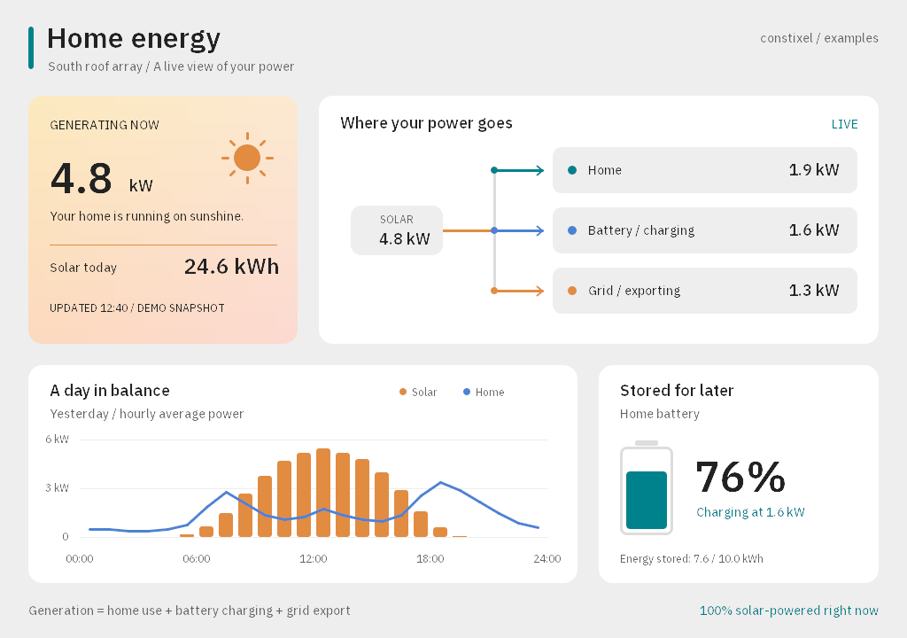 | 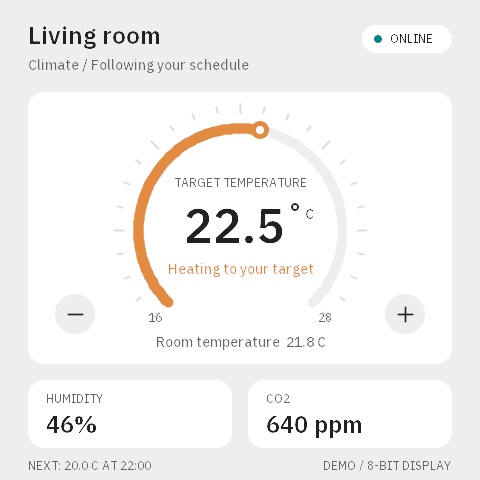 |
| [Source](energy/example_energy.cpp) · A balanced solar power-flow diagram, battery charge, and a daily generation/load chart. Useful for inverter displays and home energy monitors. | [Source](thermostat/example_thermostat.cpp) · A 480 x 480, 8-bit climate screen with a segmented arc, setpoint indicator, and sensor readings. Useful for wall controllers and small touchscreens. |

| E-paper weather | Server health |
| --- | --- |
| 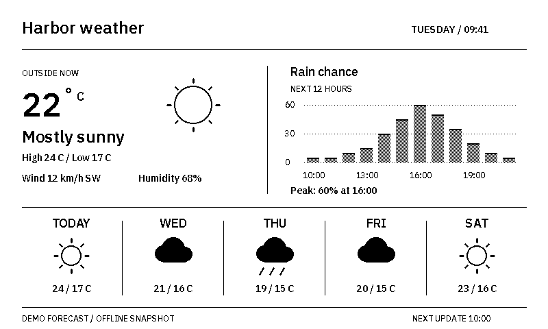 | 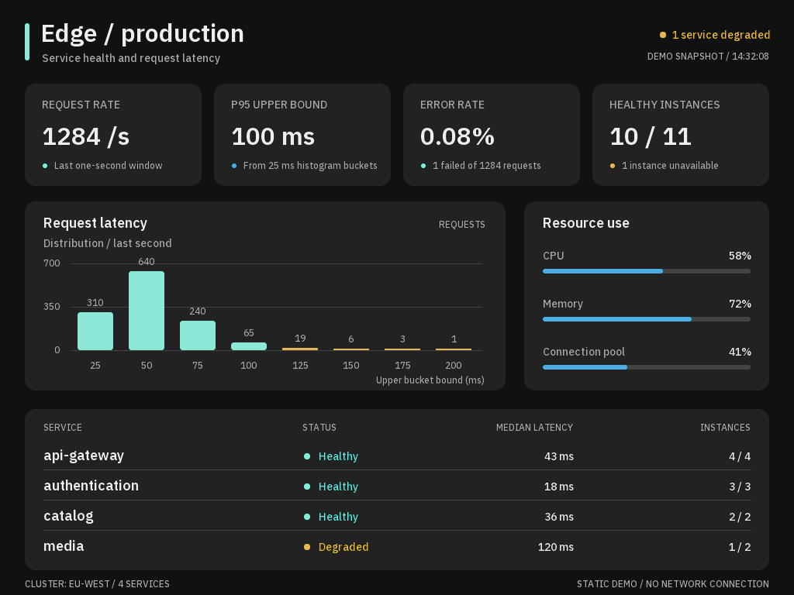 |
| [Source](weather/example_weather.cpp) · An 800 x 480, 1-bit display with procedural weather icons, stippled rain bars, and a five-day forecast. The pixel buffer occupies 48,000 bytes. | [Source](server_status/example_server_status.cpp) · A dark monitoring screen with latency buckets, resource use, and service health. Request totals, error rate, and the p95 upper bound come from the sample data. |

| Process dashboard | Music player |
| --- | --- |
| 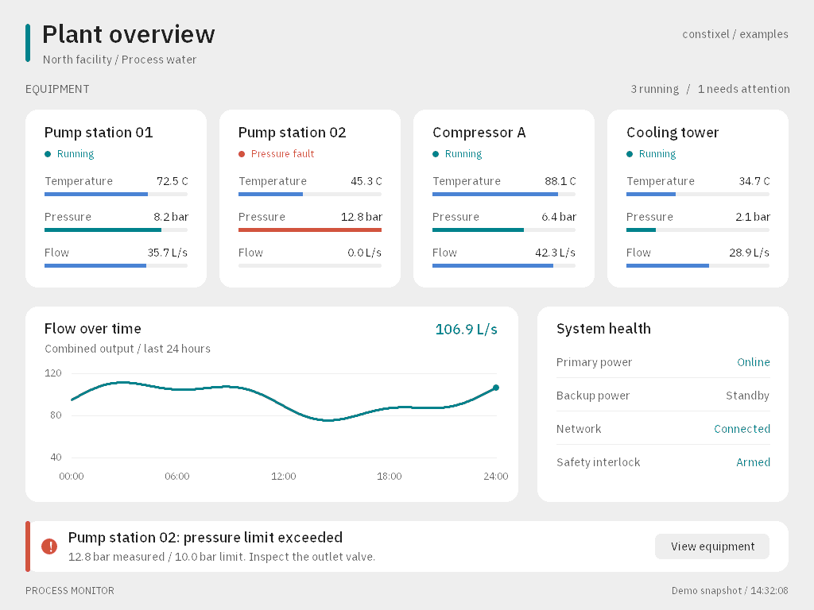 | 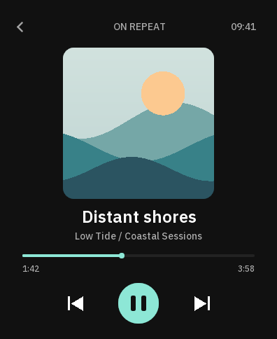 |
| [Source](industrial/example_industrial.cpp) · Equipment readings, bounded progress bars, a trend chart, and an alert. | [Source](watchui/example_watchui.cpp) · Procedural cover art, playback progress, and primitive-based controls. |

| Signal explorer | Surface study |
| --- | --- |
| 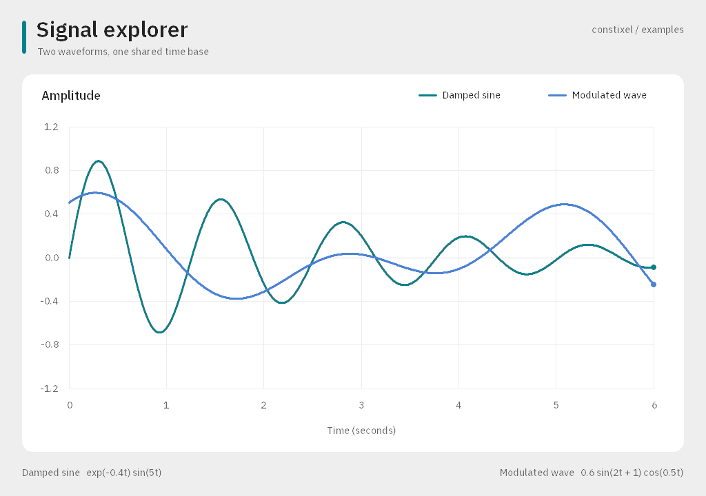 | 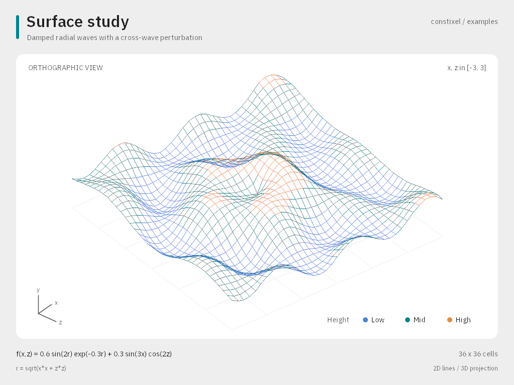 |
| [Source](graph/example_graph.cpp) · Two sampled waveforms with labeled axes and a shared scale. | [Source](visualization3d/example_visualization3d.cpp) · A complete wireframe domain projected to 2D, with a height legend. |

| Drawing essentials | Procedural fills |
| --- | --- |
| 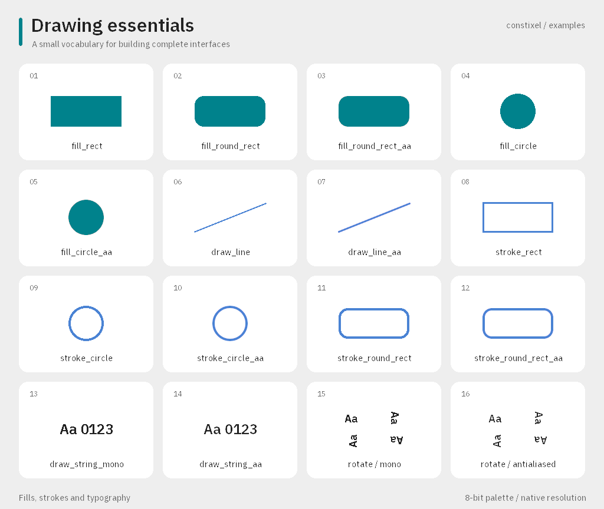 | 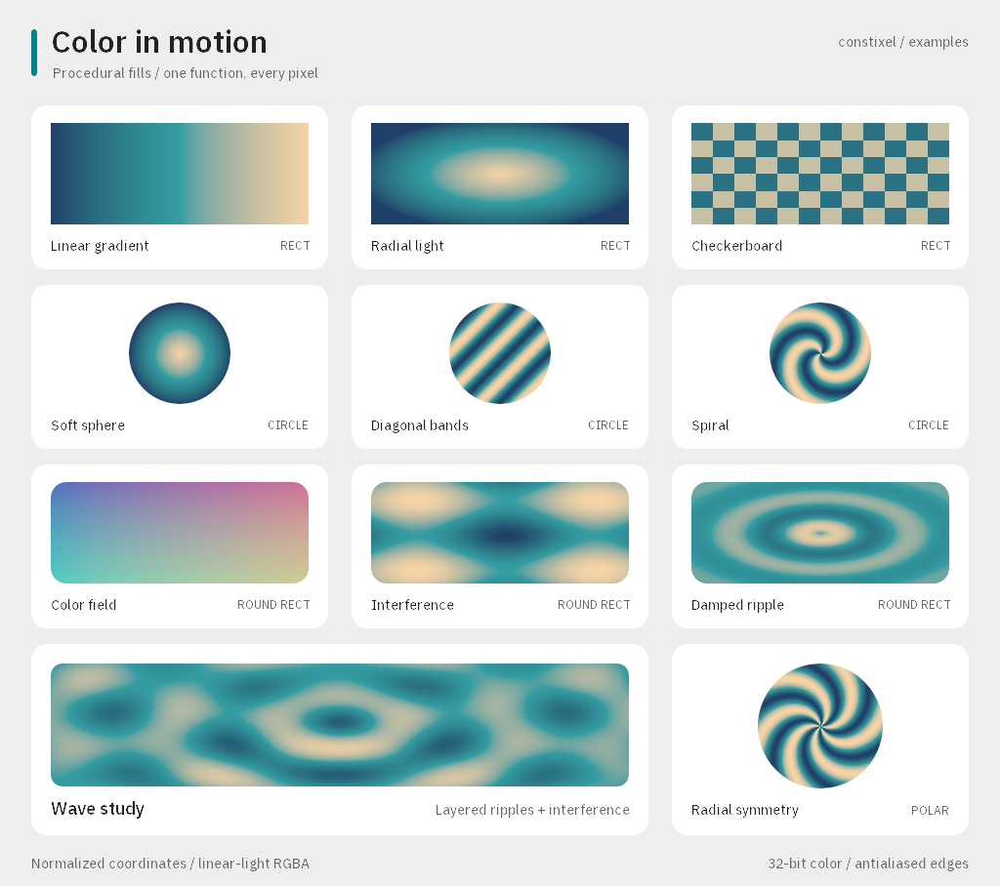 |
| [Source](drawingapi/example_drawingapi.cpp) · Fills, strokes, antialiasing, text, and all four text orientations. | [Source](shader_fill/example_shader_fill.cpp) · Gradients and patterns across rectangles, circles, and rounded rectangles. |

| Compile-time panel | Mandelbrot set |
| --- | --- |
| 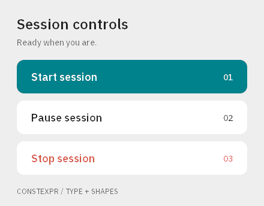 | 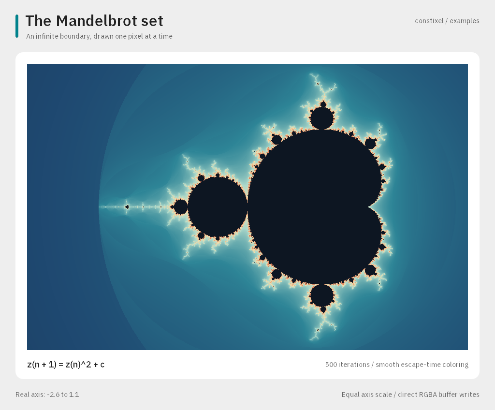 |
| [Source](text/example_text.cpp) · A complete text-and-shapes panel evaluated at compile time. | [Source](mandelbrot/example_mandelbrot.cpp) · Direct RGBA writes, smooth escape-time coloring, and equal axis scaling. |

## Smaller examples

- [Minimal](minimal/example_minimal.cpp): the smallest palette-and-sixel example.
- [Embedded](embedded/example_embedded.cpp): a 192 x 64 monochrome nitrogen-generator display with memory usage reporting.
- [Font specimen](specimen/example_specimen.cpp): a glyph sheet with Unicode code-point labels.

The color examples share [presentation helpers](example_style.hpp) for type, spacing, and palette selection, plus a small [output helper](example_output.hpp) for PNG export. The monochrome weather example uses mono fonts and integer drawing primitives directly. The library itself has no dependency on either helper.

The application examples are static rendering demonstrations: their controls are illustrative and their readings are fixtures, with no network or device access. To adapt them, replace the sample data with your own measurements and redraw the image. The thermostat's arc and the weather icons are built from lines and circles, so no icon assets or additional graphics libraries are required.
